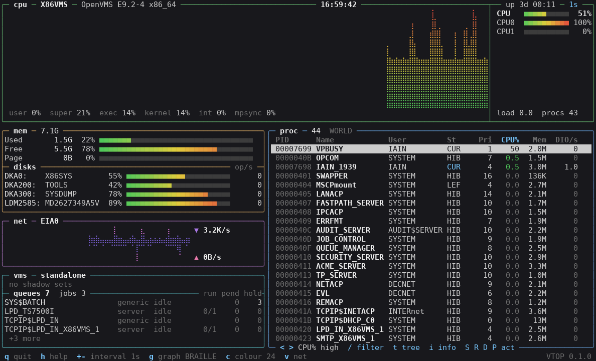
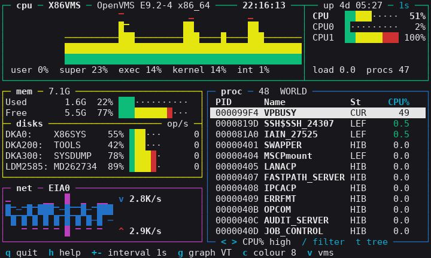

<p align="center">
  
  <br><sub>An xterm-type terminal at 132x40: braille graphs, 24-bit colour.</sub>
</p>

# vms-vtop

[](https://github.com/issinoho/vms-vtop/releases/latest)
[](https://github.com/issinoho/vms-vtop/releases)

[](LICENSE)

A full-screen, live system monitor for OpenVMS x86-64 and IA64, inspired by
[btop](https://github.com/aristocratos/btop): CPU, memory, disk and network panels with
history graphs, a process list you can sort, filter, view as a tree and act on, and a
panel for what only VMS has: the cluster, shadow sets and queues.

**Status: 0.1.0, an early test release.** Not a port: btop needs C++20, which neither
VMS compiler has, so VTOP is new C99 code that borrows btop's ideas. See
[docs/PLAN.md](docs/PLAN.md) for how it was built, phase by phase.

## What it shows

| | |
|---|---|
| **CPU** | a history graph, time by processor mode (user, super, exec, kernel, interrupt, MP synch), a meter per CPU, the compute queue |
| **Memory and disks** | used, free, modified, page and swap files; each mounted disk's use and operations per second, mount verification and offline in warning colour |
| **Network** | receive and send graphs per LAN device, with the peak and total |
| **Processes** | PID, name, user, state, priority, CPU%, CPU time, memory, direct and buffered I/O, image; sorted by any column, filtered, or as a tree by owner; details with quotas, privileges and login time |
| **VMS** | cluster members, votes and quorum; shadow sets with copy and merge progress; every queue, problem queues first |

It draws braille graphs in 24-bit colour on an xterm-type terminal, and DEC line
drawing in 8 colours (or bold and reverse alone) on a VT or DECterm; it finds out which
by asking the terminal. It uses the whole screen, 70 x 20 at least, and follows resizes.
On a VT525 at 80 x 24 the same system looks like this, with fewer process columns and
`v` to swap the net panel for the vms one:

<p align="center">
  
</p>

## Safety first

- VTOP enables no privilege. It shows the processes your privileges let you see (all
  with WORLD, your group's with GROUP, else your own; the panel's title says which).
- Suspend, resume, delete and set priority are capital letters (`S` `R` `D` `P`), so a
  lowercase slip does nothing. Each asks first, naming the PID, process, user and
  image; only `Y` says yes, and keys typed ahead are thrown away before the question.
  VMS checks each action as it would the DCL command. VTOP won't suspend or delete
  itself.
- It writes nothing unless you press `w` (your settings, to `SYS$LOGIN:VTOP.INI`).

The reasoning is in [docs/DECISIONS.md](docs/DECISIONS.md), and what the platform
was seen to do in [docs/NOTES.md](docs/NOTES.md).

## Installing

From the [latest release](https://github.com/issinoho/vms-vtop/releases/latest):

```
$ SET FILE/ATTRIBUTE=(RFM:FIX,LRL:8192,MRS:8192,RAT:NONE) ISSINOHO-*-VTOP-T0001-0-1.PCSI
$ PRODUCT INSTALL VTOP /PRODUCER=ISSINOHO /SOURCE=dev:[dir]
$ @VTOP$ROOT:[000000]VTOP$SETUP.COM
$ VTOP
```

Add `@SYS$STARTUP:VTOP$STARTUP.COM` to `SYS$MANAGER:SYSTARTUP_VMS.COM` so the `VTOP`
logical name is there after a reboot, and the setup line to `SYLOGIN.COM` or a
`LOGIN.COM` for the command.

## Using it

```
$ VTOP                       ! every 2 seconds
$ VTOP/INTERVAL=5            ! 1 to 10
$ VTOP/GRAPH=VT/COLOUR=MONO  ! a monochrome VT520
```

| Key | |
|---|---|
| `q` F10 Ctrl/Z | quit (Ctrl/C and Ctrl/Y too) |
| `h` `?` Help | every key |
| `+` `-` | refresh interval |
| `g` `c` | graph characters (braille, block, VT), colours (24-bit, 256, 8, mono) |
| `v` | net, vms or both in the bottom-left panel |
| `b` `n` | the network device shown |
| Up Down Prev Next | select a process |
| `<` `>` `r` | sort column, reverse it |
| `t` `/` | tree by owner; filter by name, user, image or PID |
| `i` Return | details of the process |
| `S` `R` `D` `P` | suspend, resume, delete, set priority (each asks first) |
| `w` | save these settings to `SYS$LOGIN:VTOP.INI` |

`VTOP$GRAPH` and `VTOP$COLOUR` set the graph and colour as the qualifiers do;
`VTOP$OPTIONS` names another options file.

## Building

On the node: `@BUILD_VMS` (add `TEST` to run the unit and screen tests too). On
Linux, `make test` builds the portable core and checks 222 things, screens included,
and `make demo` runs VTOP on your terminal with an invented system.
`tools/kit.sh <node>` makes a PCSI kit.

VTOP is unrelated to btop and contains none of its code or themes.

## Licence

MIT. See [LICENSE](LICENSE).
